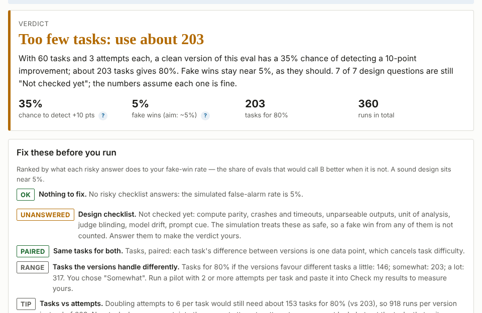
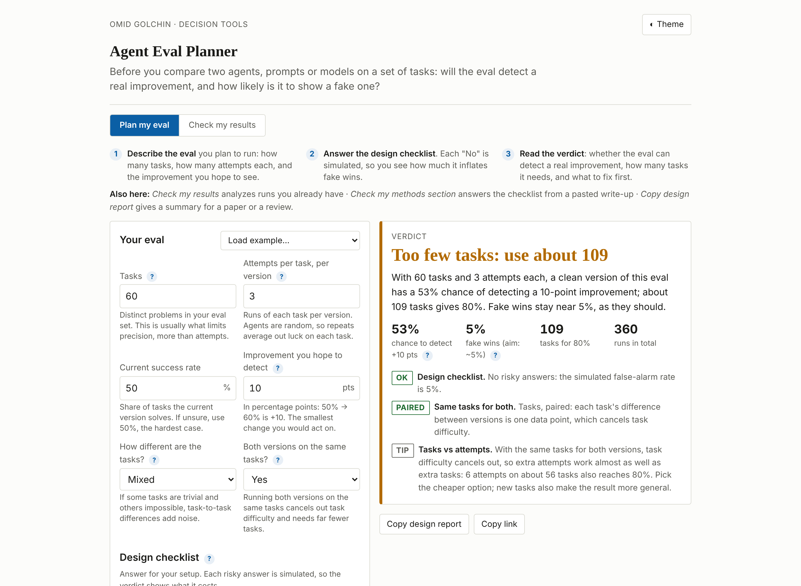

# Agent Eval Planner

For anyone comparing two AI agents, prompts or models on a set of tasks: before you run the eval, see how likely it is to detect the improvement you care about, how likely it is to show a fake one, how many tasks you need, and which design choices to fix. After you run it, paste the results and get the honest interval.





**Use it:** https://omidgolchin.github.io/experiment-hazard-simulator/ (runs in your browser; nothing you type leaves it)

## What it does

- **Plan my eval (Before you run).** One question per card: tasks, attempts per task, current success rate and the improvement you hope to detect give the chance to detect it, the tasks needed for 80%, and the fake-win rate of your design. Because how differently the two versions handle individual tasks is hard to know in advance, the verdict also shows the tasks needed if they differ a little, somewhat or a lot. An eight-question checklist covers the ways agent evals go wrong; each risky answer is simulated, and the verdict ends with a ranked list of what to fix first. A "Jump to the verdict" link under every card takes you straight to the verdict with the answers you have given so far.
- **Check my results (After you run).** Paste one row per attempt (task, version, attempt, success) or upload a CSV. You get the difference with a task-level interval (paired t and a task bootstrap), next to the interval you would get by pooling attempts, plus checks for unequal compute and tasks that ran on only one version. With 2 or more attempts per task, it also measures how much the versions favour different tasks and says which setting to plan the next eval with.
- **Check my methods section (After you run).** Paste the write-up of an eval (yours or a paper's). A language model (your key, or copy the prompt into any assistant) answers the checklist from it, quoting the sentence behind each answer, and lists what the write-up never states. The simulation then scores the design.
- **Copy design report.** A Markdown checklist with the numbers, ready for a paper appendix or a pull request.
- **Start here.** The page opens with the question it answers and three steps; a list of common situations fills the design; and a section says when to use the tool and when not.
- **Help where you need it.** Each view opens with one line saying what to enter and what you get; every wizard card adds a line saying why the question matters; every input has a line under it saying what the number is, why it matters and where to find it; and every technical term in the inputs and results has a **?** that opens a plain-language explanation.

## Built-in checks

| Check | What it catches |
|---|---|
| Compute parity | One version gets more attempts, retries or budget (best-of-k): a fake win almost every time. |
| Crashes and timeouts | Dropping crashed runs or tasks for one version; the planner shows whether it biases the result or just costs power. |
| Unparseable outputs | Different rules for unparseable outputs in each version. |
| Unit of analysis | Pooling attempts as if independent. With separate task sets this inflates fake wins. With shared tasks it wastes power if the versions handle every task alike, and inflates fake wins if they favour different tasks. The planner shows which. |
| Judge blinding | An LLM judge that can see which version produced an output. |
| Model drift | Versions run at different times or on a changed model. |
| Prompt cue | Prompts that differ in more than the thing being tested. |
| Metrics examined | Picking the best of several metrics after the fact. |
| Tasks vs attempts | How much more attempts per task can replace more tasks in your design. Attempts average out luck, not the tasks that suit one version better, so they usually cannot. |

## Design decisions

- **The task is the unit of analysis.** Attempts on the same task succeed or fail together, so the planner analyzes per-task success rates: a paired t-test when both versions run on the same tasks, Welch otherwise (Hurlbert 1984 on pseudo-replication).
- **Paired by default.** Running both versions on the same tasks cancels task difficulty. The planner shows how many more tasks separate task sets would need.
- **Every hazard is simulated, not just listed.** Each "no" in the checklist is run through the simulation alone, so the verdict separates hazards that create fake wins from ones that only cost power and ones that barely matter at your settings.
- **Fake wins count significant differences in either direction**, so a sound design sits at 5%; the chance to detect counts only wins for the new version.
- **Sample size from the simulated spread of per-task differences**, n = ((z₀.₉₇₅ + z₀.₈) · sd / gain)² + 1, checked against simulated power on the chart (tested: the formula's task count delivers 80% ± 3 points).
- **Some tasks suit one version better.** Each task gets a shift between the versions that repeat attempts cannot average away (normal on the log-odds scale, split equally between A and B so neither starts ahead). The four settings give about 0%, 10%, 25% and 50% of the single-attempt spread in per-task differences. "A lot" matches two different models on real runs (41–61% measured); the smaller settings are assumptions, so the verdict shows the task count for each.
- **Improvements in points, not log-odds.** You enter the improvement in success-rate points; the planner converts it to the model's scale by quadrature over task difficulty.
- **The AI check only reads.** It answers the checklist from text and must quote its source; the statistics stay in code.

## Validation

- **Checked against real runs.** The planner's task counts were tested on 6,000 real runs: three models on the same 400 GSM8K questions, 5 runs each, from the [error-bars study](https://github.com/omidgolchin/llm-eval-error-bars). For each pair of models, evals of the planned size were drawn again and again from the real runs, and we counted how often they found the real gain (`validation/check_real_runs.py`, results in `validation/results.json`):

  | Real power of a plan for 80% | 1 run per question | 3 runs | 5 runs |
  |---|---|---|---|
  | Before this fix (same effect on every task) | 0.76–0.95 | 0.53–0.69 | 0.41–0.49 |
  | Setting "A lot, like two models" | 0.87–0.99 | 0.91–0.98 | 0.89–0.98 |

  Without the task-by-version shift, the planner promised 80% and, at 5 runs per question, delivered about half that, because it treated extra runs as nearly as good as extra questions. With the setting that matches two different models, every plan reached at least 80% (a little above, so the plans are on the safe side). The smaller settings could not be checked against real data here.
- **47 tests** (`pytest`): false alarms of the clean design at 5%; the sample-size formula delivering 80%; with the task-by-version shift, false alarms still at 5% (also away from a 50% rate), pooled attempts faking wins even with shared tasks, attempts unable to remove it, each setting giving its stated share, and the planned task counts delivering their power on the real runs; each hazard raising false alarms; pooling attempts inflating false alarms only without pairing; the JavaScript engine against the NumPy reference (`sim/planner.py`) on false alarms, power and effect sizes; the results checker against `scipy.stats.ttest_1samp`; detection of unequal compute and unmatched tasks; the original hazard simulator's JS/Python agreement; the AI check's prompt and reply handling; the wizard's "Jump to the verdict" control, including a browser check that the verdict it lands on matches the full walk-through (`scripts/check_wizard_jump.js`).
- **AI check extraction:** a 20-item test set of methods paragraphs (`assist/testset.json`), from careful to careless to silent. Score any model with `ANTHROPIC_API_KEY=... node scripts/eval_assist.js`. Not yet run for this release.
- Checked on desktop and phone widths, in light and dark themes.

## What I learned

- Pseudo-replication surprised me twice. In my simulation it inflated
  false positives only when each condition drew its own task sample, and
  turned conservative when both ran the same tasks. Real runs said
  otherwise: two models on the same GSM8K questions favour different
  questions, and the pooled interval covered the true difference only
  85–88% of the time. My simulation had given every task the same
  effect, and that one assumption also made extra attempts look almost
  as good as extra tasks. Checking the planner against real data caught
  it; a simulation can only find what its model allows.
- I modeled exclusion wrong the first time. Dropping single runs is
  mostly absorbed by the per-task analysis. The bias appears when a hard
  task breaks the treated agent and all of its runs are lost together,
  so exclusion is modeled at task level.
- The baseline test matters more than I expected. A z test put the clean
  design at 6.4% false positives, which would have blurred every hazard's
  number. A Welch t-test holds the clean rate at 5%, so the departures
  belong to the hazards.
- What I would do differently: read the skill's exact wording before
  building. The skill repo was private when I built this, so the check
  wordings come from the spec's summary of the skill. They may need
  updating to match it word for word.

## Common situations

The form opens with "Start from a common situation". Each entry fills the form and says what it shows:

| Situation | What it shows |
|---|---|
| Small agent benchmark (60 tasks) | A clean design; the only question is whether 60 tasks are enough. |
| Judged chat eval with retries for the new version | Retries, an unblinded judge and dropped crashes together. |
| Large coding benchmark (300 tasks) | Many tasks, one attempt each, a small gain. |
| Separate task sets, attempts pooled | The setting where pooling fakes wins. |
| Five metrics, report the best | Each extra metric is another chance at a fake win. |
| New run against last month's baseline numbers | Model or API drift counts as an improvement. |
| Prompt test where the prompts differ in more than one way | Wording that hints at the expected behavior wins on its own. |

Settings are illustrative. To add a situation, append an entry to `EXAMPLES` and its note to `WHY_EX` in `docs/app.js`.

## When to use it, and when not

Use it before running an eval that compares two versions of an agent, prompt or model on a fixed set of tasks scored pass or fail, to size it and fix the design; and after it, to read the result per task rather than per attempt.

| It assumes | If yours differs |
|---|---|
| Each attempt is scored pass or fail. | Graded scores (a 1-to-10 judge rating, partial credit) need a different model. As a first cut, set a pass threshold and use pass rates. |
| Tasks differ in difficulty, and attempts on the same task succeed or fail together. | This is what makes the task the unit of analysis. If your tasks are near-identical, pooling attempts matters less. |
| The improvement is the same size on every task. | Real improvements are larger on some tasks and zero on others. The chance to detect is then lower than shown; ask for a larger task count. |
| Each hazard's strength is a setting you choose (the default is a realistic middle value). | The tool shows the mechanism and its scale, not how strong a hazard is in your eval. Move the slider to the strength you suspect. |
| The comparison is between two versions. | For several versions, compare each with the baseline and correct for the number of comparisons, or plan a larger eval. |
| Success rates are not near 0% or 100%. | Near the extremes, few tasks carry information. Make the task set harder or easier first. |

Do not use it for open-ended human preference studies (use a paired-preference design with its own power analysis), for tracking a single model's score over time, or as proof that an eval is sound: a clean verdict means the hazards it checks are handled, not that the tasks measure what you care about.

## Where it comes from, and how it was generalised

The tool comes out of a study, ["How design hazards fake wins in LLM-agent experiments"](https://github.com/omidgolchin/agent-eval-hazards-study). It simulated two conditions with no real difference, added one design hazard at a time, and counted how often the study would still report a significant improvement. With no hazard the rate is 5%, as it should be. With one:

- **Best-of-3 for the new version alone** gave fake wins in 91% of evals.
- **Picking the best of five metrics** gave 22%, and an **unblinded judge** that flips 20% of the new version's failures gave 20%.
- **Pooling attempts as if independent** gave 13% when each condition had its own tasks, and was harmless when tasks were all alike.
- **Dropping crashed hard tasks** barely moved the fake-win rate: it costs power, not validity.
- **Small studies also miss real effects:** at 20 tasks a clean design detected a modest effect only 10% of the time.

**How it was generalised.** The study fixed 20 tasks, 5 attempts and a 50% success rate, with separate task sets per condition. The tool runs the same simulation on your design: your task count, attempts, success rate, hoped-for improvement and pairing (both versions on the same tasks is the default, which the study did not cover), with each "no" in the checklist simulated on its own so the verdict can rank what to fix. It adds a results checker and an AI reader for methods sections; the reader only answers the checklist from the text, and the statistics stay in code. The study repository holds its question, frozen plan, results and limitations; the copies of its scripts and outputs kept here are what this tool's tests check against.

## Run it

```bash
python3 -m venv .venv && .venv/bin/pip install -r requirements.txt
.venv/bin/python -m pytest -q          # all tests (needs node for the JavaScript checks)
cd docs && python3 -m http.server 8000  # the tool at http://localhost:8000
.venv/bin/python -m sim.analyze         # regenerate results/ (research notes)
```

## Layout

- `docs/`: the tool (plain HTML and JavaScript, no build step). `evalsim.js` is the engine (simulation, sample size, results checker); `tool-common.js` and `tool.css` the shared tool kit; `assist-config.js` the AI check's prompt.
- `sim/planner.py`: NumPy reference for the engine. `sim/model.py`, `sim/hazard_sim.js`, `sim/analyze.py`: the hazard sweeps in Research notes.
- `assist/` and `scripts/eval_assist.js`: the AI check's test set and scorer.

## Limitations

- Binary success per attempt; graded scores need a different model.
- One improvement size and one baseline rate per plan; real improvements vary by task.
- Hazard strengths are illustrative defaults you can change; the checklist cannot know how strong a hazard is in your setup, only that it is there.

## References

- Hurlbert, S. H. (1984). Pseudoreplication and the design of ecological
  field experiments. *Ecological Monographs*, 54(2), 187–211.
  https://www.jstor.org/stable/1942661
- Simmons, J. P., Nelson, L. D., & Simonsohn, U. (2011). False-positive
  psychology: Undisclosed flexibility in data collection and analysis
  allows presenting anything as significant. *Psychological Science*,
  22(11), 1359–1366. https://doi.org/10.1177/0956797611417632
- Panickssery, A., Bowman, S. R., & Feng, S. (2024). LLM evaluators
  recognize and favor their own generations. *NeurIPS 2024*.
  https://arxiv.org/abs/2404.13076
- Zheng, L., Chiang, W.-L., Sheng, Y., et al. (2023). Judging
  LLM-as-a-judge with MT-bench and Chatbot Arena. *NeurIPS 2023*, 36,
  46595–46623.
- Golchin, O. agent-experiment-methodology skill: the audit checklist
  this simulator is built from.
  https://github.com/omidgolchin/agent-experiment-methodology

## Citation and license

Author: Omid Golchin. If you use this simulator, please cite it. See
[CITATION.cff](CITATION.cff). Code and text are released under the
[MIT License](LICENSE).
