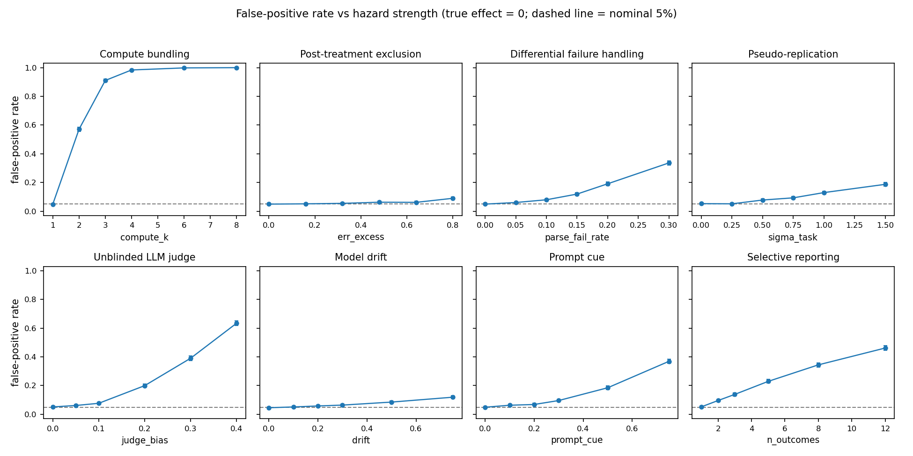

# Experiment hazard simulator

This simulator measures what eight design hazards do to an experiment on
LLM agents. Each hazard comes from my
[agent-experiment-methodology](https://github.com/omidgolchin/agent-experiment-methodology)
skill and gets one toggle and one check.

Best-of-3 compute bundling alone produces a 91% false-positive rate.
Post-treatment exclusion barely moves a study of this size: 5.3% against
a clean 5.0%.

**All data in this repository and on the playground page are simulated.**
No real experiment was run and no API was called.

## The result

I simulated experiments that compare a control condition A and a treatment
condition B on 20 tasks with 5 seeds each, with a true effect of zero, and
counted how often each design reports a significant effect at α = 0.05. A
clean design gives a false-positive rate of 5.0%, as it should. With one
hazard at a realistic setting:

- **Compute bundling** (B gets best-of-3 attempts): 91% false positives,
  mean estimated effect +0.30 on a success-rate scale where the truth is 0.
- **Selective reporting** (best of 5 outcomes): 22%.
- **Unblinded LLM judge** (judge upgrades 20% of B's failures): 20%, bias +0.10.
- **Prompt cue** (demand effect of 0.4 on the logit scale): 14%.
- **Pseudo-replication** (seeds counted as tasks, task spread σ = 1): 13%.
- **Differential failure handling** (15% parse failures, wrong in B, missing in A): 13%, bias −0.07.
- **Model drift** (+0.5 logit shift halfway through B's sequential block): 7.8%.
- **Post-treatment exclusion** (B's hard tasks error out): 5.3% at this study
  size, the mildest of the eight here. Its bias (+0.02) is roughly constant
  while standard errors shrink, so it bites harder in larger studies. At
  the strongest setting I swept it reaches 9.0%.

Two hazards at once (best-of-3 plus a naive standard error) give 97%. And
one case is harmless: pseudo-replication with homogeneous tasks
(σ_task = 0) stays at 5.3%, because with no task-level variance there is
nothing for the naive standard error to miss. Full numbers, sweeps and
Monte Carlo errors are in [results/summary.md](results/summary.md).

The clean design is weak in the other direction. With 20 tasks it has
10% power at a true effect of δ = 0.3, so a real effect of that size is
missed nine times out of ten.



## Playground

The playground runs the same simulation in your browser: 1,000 simulated
experiments per setting, hazards as toggles, presets for the clean design,
each hazard, two hazards at once, and the harmless case above. The live
link goes up when this repo becomes public:
https://omidgolchin.github.io/experiment-hazard-simulator/
Until then, serve `docs/` locally (see "Use the code" below). Every
active hazard shows the check that catches it, quoted with a link to
the skill.

## The eight hazards

| Hazard | What goes wrong | The check that catches it |
|---|---|---|
| Compute bundling | B also gets more attempts per task (best-of-k), so the estimate mixes the treatment with extra compute | Run a compute-matched arm: give the control the same steps and samples before crediting the treatment |
| Post-treatment exclusion | Runs that hit an error are dropped after the fact, and B errors out on hard tasks, so B's surviving tasks are easier | Audit when exclusions happen and analyse intention-to-treat: every run you started counts |
| Differential failure handling | Parse failures are counted as missing in one arm and as wrong in the other, so the same event moves only one rate | Use one failure rule in both arms: a parse failure is missing everywhere or wrong everywhere |
| Pseudo-replication | Seeds are treated as independent tasks and a naive pooled standard error is used, so the sample looks S times larger than it is | Set the replication unit to the task: cluster standard errors by task, never count seeds as tasks |
| Unblinded LLM judge | The judge sees the condition label and upgrades some of B's failures to successes | Blind the judge to condition labels and validate it against human labels before trusting its scores |
| Model drift | Conditions run in sequence instead of interleaved, and the model version changes halfway through B, so the version change is credited to the treatment | Interleave the conditions and pin the model version for the whole run |
| Prompt cue | B's prompt hints at the expected behaviour, adding a demand effect that is not the treatment | Diff the two prompts: they may differ only in the factor under test |
| Selective reporting | Several outcomes are measured and only the most significant is reported, with no multiplicity correction | Pre-specify one primary outcome and correct for multiplicity across the rest |

## Use the code

```bash
pip install -r requirements.txt

python -m sim.analyze        # regenerate results/summary.md, figures, docs/data
pytest                       # behavioural tests + JS/Python agreement test
node sim/js_check.mjs        # regenerate the saved JS outputs used by the agreement test
```

```python
from sim.model import Settings, simulate_experiments

# True effect is zero; B quietly gets best-of-3 attempts.
r = simulate_experiments(Settings(compute_k=3), n_exp=1000, seed=1)
print(r["rate"], r["mean_estimate"])   # false-positive rate, mean estimate
```

Serve the playground locally with `python -m http.server -d docs 8000`.

## How it was done

Each condition runs on its own sample of T tasks with S seeds per task.
Task difficulty is Normal(0, σ_task) on the logit scale; a run succeeds
with probability sigmoid(base + difficulty + δ·B + noise). The correct
analysis is the difference in success rates with a two-sample Welch
standard error over per-task means. The task is the replication unit.
Each hazard changes generation or analysis exactly as described in
[PLAN.md](PLAN.md), which was frozen (with `FREEZE_MANIFEST.txt`) before
the sweeps ran; deviations and judgement calls are in
[DECISIONS.md](DECISIONS.md).

Two design notes matter. First, the task samples are *unpaired*: if both
conditions ran on exactly the same tasks, difficulty would cancel in the
paired difference and the naive pooled standard error would be
conservative rather than anti-conservative. The pseudo-replication
inflation appears when each condition's task sample is its own draw.
Second, exclusion is modelled at task level for B: run-level dropout is
mostly absorbed by a task-mean analysis, while a hard task breaking the
treated agent loses all of its runs together, which is what biases the
estimate.

The model is implemented twice: Python (`sim/`, NumPy) for the sweeps
above and JavaScript (`docs/sim.js`) for the playground. The test suite
checks that the two agree on the false-positive rate within Monte Carlo
error on three settings (clean, pseudo-replication, compute bundling;
20,000 experiments each).

## What I learned

- Pseudo-replication surprised me. It inflates false positives only when
  each condition draws its own task sample. Run both conditions on the
  same tasks and the naive standard error turns conservative instead.
- I modelled exclusion wrong the first time. Dropping single runs is
  mostly absorbed by the per-task analysis. The bias appears when a hard
  task breaks the treated agent and all of its runs are lost together,
  so exclusion is modelled at task level.
- The baseline test matters more than I expected. A z test put the clean
  design at 6.4% false positives, which would have blurred every hazard's
  number. A Welch t-test holds the clean rate at 5%, so the departures
  belong to the hazards.
- What I would do differently: read the skill's exact wording before
  building. The skill repo was private when I built this, so the check
  wordings come from the spec's summary of the skill. They may need
  updating to match it word for word.

## Limitations

- This is a teaching model, not a measurement of real experiments. The
  hazard strengths are parameters I chose; real studies will sit at
  unknown points on each sweep.
- Success is a single Bernoulli outcome per run. Real agent tasks have
  graded scores, partial credit and correlated failure modes.
- Each hazard is modelled in its simplest form (for example, the judge's
  bias is a flat upgrade probability; drift is a single step change).
  Real versions can be larger, smaller, or interact.
- The eight hazards act one or two at a time here. Real studies can have
  several at once, in either direction.

## References

- Hurlbert, S. H. (1984). Pseudoreplication and the design of ecological
  field experiments. *Ecological Monographs*, 54(2), 187–211.
  https://www.jstor.org/stable/1942661
- Simmons, J. P., Nelson, L. D., & Simonsohn, U. (2011). False-positive
  psychology: Undisclosed flexibility in data collection and analysis
  allows presenting anything as significant. *Psychological Science*,
  22(11), 1359–1366. https://doi.org/10.1177/0956797611417632
- Panickssery, A., Bowman, S. R., & Feng, S. (2024). LLM evaluators
  recognize and favor their own generations. *NeurIPS 2024*.
  https://arxiv.org/abs/2404.13076
- Zheng, L., Chiang, W.-L., Sheng, Y., et al. (2023). Judging
  LLM-as-a-judge with MT-bench and Chatbot Arena. *NeurIPS 2023*, 36,
  46595–46623.
- Golchin, O. agent-experiment-methodology skill: the audit checklist
  this simulator is built from.
  https://github.com/omidgolchin/agent-experiment-methodology

## Citation and license

Author: Omid Golchin. If you use this simulator, please cite it. See
[CITATION.cff](CITATION.cff). Code and text are released under the
[MIT License](LICENSE).
