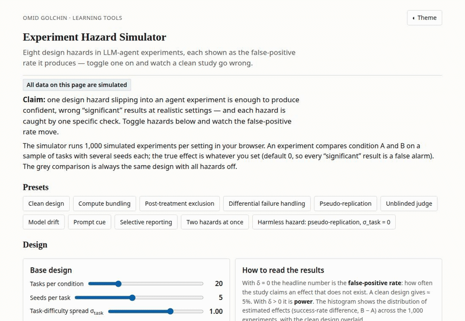
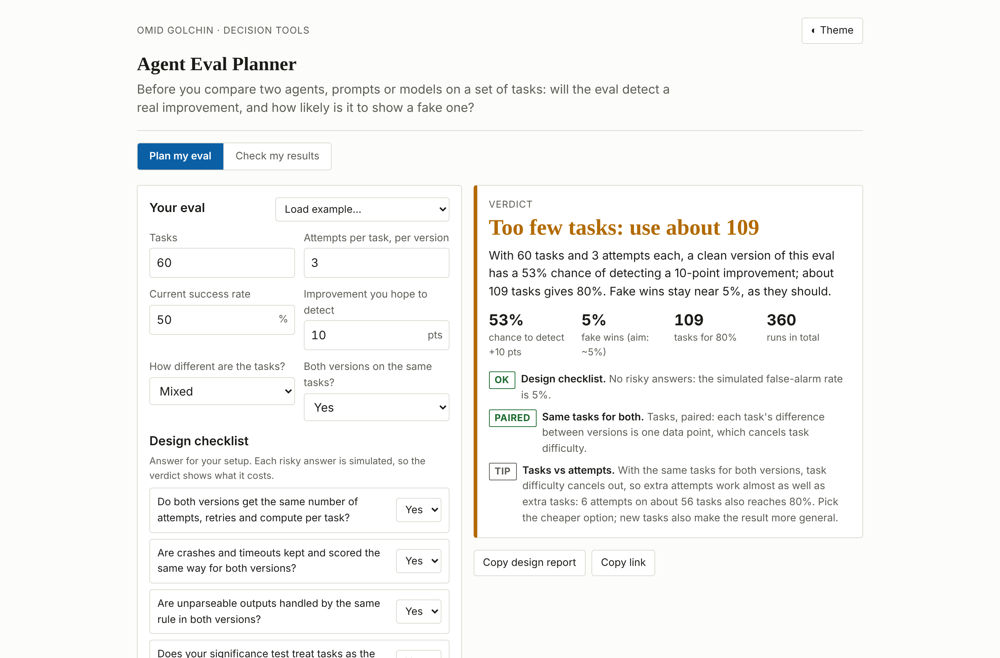

# Agent Eval Planner

For anyone comparing two AI agents, prompts or models on a set of tasks: before you run the eval, see how likely it is to detect the improvement you care about, how likely it is to show a fake one, how many tasks you need, and which design choices to fix. After you run it, paste the results and get the honest interval.





**Use it:** https://omidgolchin.github.io/experiment-hazard-simulator/ (runs in your browser; nothing you type leaves it)

## What it does

- **Plan my eval.** Tasks, attempts per task, current success rate and the improvement you hope to detect give the chance to detect it, the tasks needed for 80%, and the fake-win rate of your design. An eight-question checklist covers the ways agent evals go wrong; each risky answer is simulated, so the verdict says what it costs.
- **Check my results.** Paste one row per attempt (task, version, attempt, success) or upload a CSV. You get the difference with a task-level interval (paired t and a task bootstrap), next to the interval you would get by pooling attempts, plus checks for unequal compute and tasks that ran on only one version.
- **Check my methods section.** Paste the write-up of an eval (yours or a paper's). A language model (your key, or copy the prompt into any assistant) answers the checklist from it, quoting the sentence behind each answer, and lists what the write-up never states. The simulation then scores the design.
- **Copy design report.** A Markdown checklist with the numbers, ready for a paper appendix or a pull request.

## Built-in checks

| Check | What it catches |
|---|---|
| Compute parity | One version gets more attempts, retries or budget (best-of-k): a fake win almost every time. |
| Crashes and timeouts | Dropping crashed runs or tasks for one version; the planner shows whether it biases the result or just costs power. |
| Unparseable outputs | Different rules for unparseable outputs in each version. |
| Unit of analysis | Pooling attempts as if independent. With separate task sets this inflates fake wins; with shared tasks it wastes power instead. The planner shows which. |
| Judge blinding | An LLM judge that can see which version produced an output. |
| Model drift | Versions run at different times or on a changed model. |
| Prompt cue | Prompts that differ in more than the thing being tested. |
| Metrics examined | Picking the best of several metrics after the fact. |
| Tasks vs attempts | Whether more attempts per task can substitute for more tasks in your design. |

## Design decisions

- **The task is the unit of analysis.** Attempts on the same task succeed or fail together, so the planner analyzes per-task success rates: a paired t-test when both versions run on the same tasks, Welch otherwise (Hurlbert 1984 on pseudo-replication).
- **Paired by default.** Running both versions on the same tasks cancels task difficulty. The planner shows how many more tasks separate task sets would need.
- **Every hazard is simulated, not just listed.** Each "no" in the checklist is run through the simulation alone, so the verdict separates hazards that create fake wins from ones that only cost power and ones that barely matter at your settings.
- **Fake wins count significant differences in either direction**, so a sound design sits at 5%; the chance to detect counts only wins for the new version.
- **Sample size from the simulated spread of per-task differences**, n = ((z₀.₉₇₅ + z₀.₈) · sd / gain)² + 1, checked against simulated power on the chart (tested: the formula's task count delivers 80% ± 3 points).
- **Improvements in points, not log-odds.** You enter the improvement in success-rate points; the planner converts it to the model's scale by quadrature over task difficulty.
- **The AI check only reads.** It answers the checklist from text and must quote its source; the statistics stay in code.

## Validation

- **30 tests** (`pytest`): false alarms of the clean design at 5%; the sample-size formula delivering 80%; each hazard raising false alarms; pooling attempts inflating false alarms only without pairing; the JavaScript engine against the NumPy reference (`sim/planner.py`) on false alarms, power and effect sizes; the results checker against `scipy.stats.ttest_1samp`; detection of unequal compute and unmatched tasks; the original hazard simulator's JS/Python agreement; the AI check's prompt and reply handling.
- **AI check extraction:** a 20-item test set of methods paragraphs (`assist/testset.json`), from careful to careless to silent. Score any model with `ANTHROPIC_API_KEY=... node scripts/eval_assist.js`. Not yet run for this release.
- Checked on desktop and phone widths, in light and dark themes.

## What I learned

- Pseudo-replication surprised me. It inflates false positives only when
  each condition draws its own task sample. Run both conditions on the
  same tasks and the naive standard error turns conservative instead.
- I modeled exclusion wrong the first time. Dropping single runs is
  mostly absorbed by the per-task analysis. The bias appears when a hard
  task breaks the treated agent and all of its runs are lost together,
  so exclusion is modeled at task level.
- The baseline test matters more than I expected. A z test put the clean
  design at 6.4% false positives, which would have blurred every hazard's
  number. A Welch t-test holds the clean rate at 5%, so the departures
  belong to the hazards.
- What I would do differently: read the skill's exact wording before
  building. The skill repo was private when I built this, so the check
  wordings come from the spec's summary of the skill. They may need
  updating to match it word for word.

## Research notes

The simulation studies behind the tool, kept out of it on purpose. Full numbers in [results/summary.md](results/summary.md). All data are simulated.

- **Each hazard alone, at a realistic strength** (20 tasks, 5 attempts, no real effect): best-of-3 for the new version gave fake wins in 91% of evals; an unblinded judge upgrading 20% of failures, 20%; selective reporting of the best of 5 metrics, 22%; dropping crashed hard tasks, about 5% (it costs power, not validity). 
- **Small agent studies miss real effects too.** At 20 tasks the clean design detected a modest real effect only 10% of the time.

## Run it

```bash
python3 -m venv .venv && .venv/bin/pip install -r requirements.txt
.venv/bin/python -m pytest -q          # all tests (needs node for the JavaScript checks)
cd docs && python3 -m http.server 8000  # the tool at http://localhost:8000
.venv/bin/python -m sim.analyze         # regenerate results/ (research notes)
```

## Layout

- `docs/`: the tool (plain HTML and JavaScript, no build step). `evalsim.js` is the engine (simulation, sample size, results checker); `tool-common.js` and `tool.css` the shared tool kit; `assist-config.js` the AI check's prompt.
- `sim/planner.py`: NumPy reference for the engine. `sim/model.py`, `sim/hazard_sim.js`, `sim/analyze.py`: the hazard sweeps in Research notes.
- `assist/` and `scripts/eval_assist.js`: the AI check's test set and scorer.

## Limitations

- Binary success per attempt; graded scores need a different model.
- One improvement size and one baseline rate per plan; real improvements vary by task.
- Hazard strengths are illustrative defaults you can change; the checklist cannot know how strong a hazard is in your setup, only that it is there.

## References

- Hurlbert, S. H. (1984). Pseudoreplication and the design of ecological
  field experiments. *Ecological Monographs*, 54(2), 187–211.
  https://www.jstor.org/stable/1942661
- Simmons, J. P., Nelson, L. D., & Simonsohn, U. (2011). False-positive
  psychology: Undisclosed flexibility in data collection and analysis
  allows presenting anything as significant. *Psychological Science*,
  22(11), 1359–1366. https://doi.org/10.1177/0956797611417632
- Panickssery, A., Bowman, S. R., & Feng, S. (2024). LLM evaluators
  recognize and favor their own generations. *NeurIPS 2024*.
  https://arxiv.org/abs/2404.13076
- Zheng, L., Chiang, W.-L., Sheng, Y., et al. (2023). Judging
  LLM-as-a-judge with MT-bench and Chatbot Arena. *NeurIPS 2023*, 36,
  46595–46623.
- Golchin, O. agent-experiment-methodology skill: the audit checklist
  this simulator is built from.
  https://github.com/omidgolchin/agent-experiment-methodology

## Citation and license

Author: Omid Golchin. If you use this simulator, please cite it. See
[CITATION.cff](CITATION.cff). Code and text are released under the
[MIT License](LICENSE).
